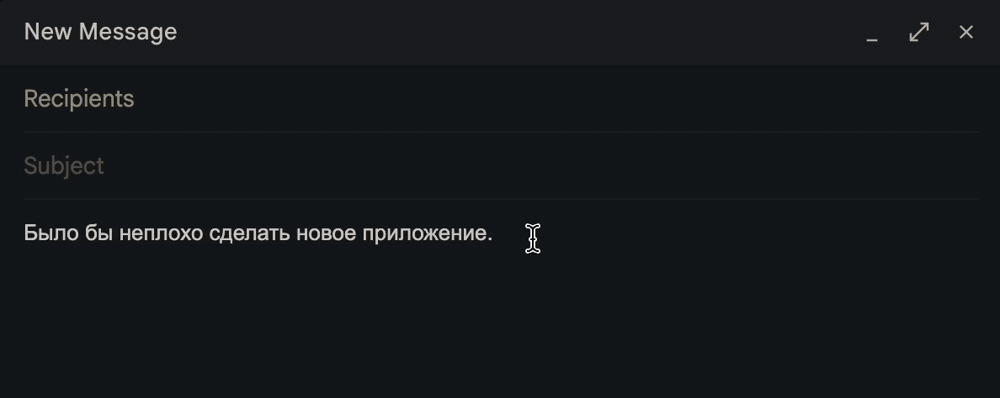
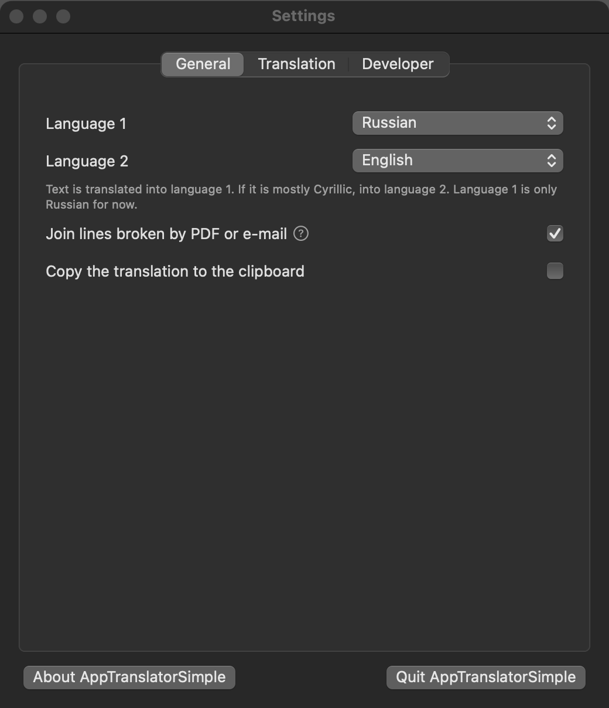
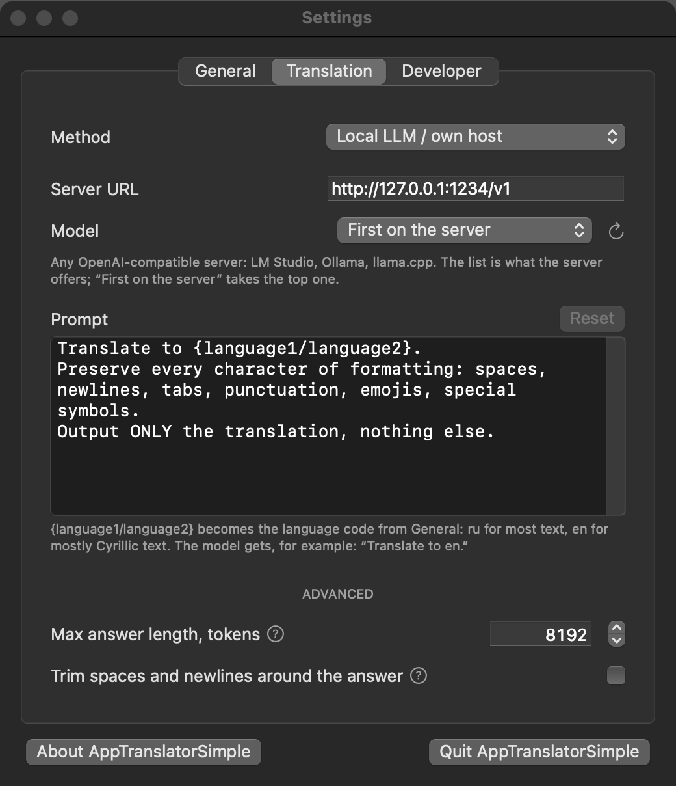
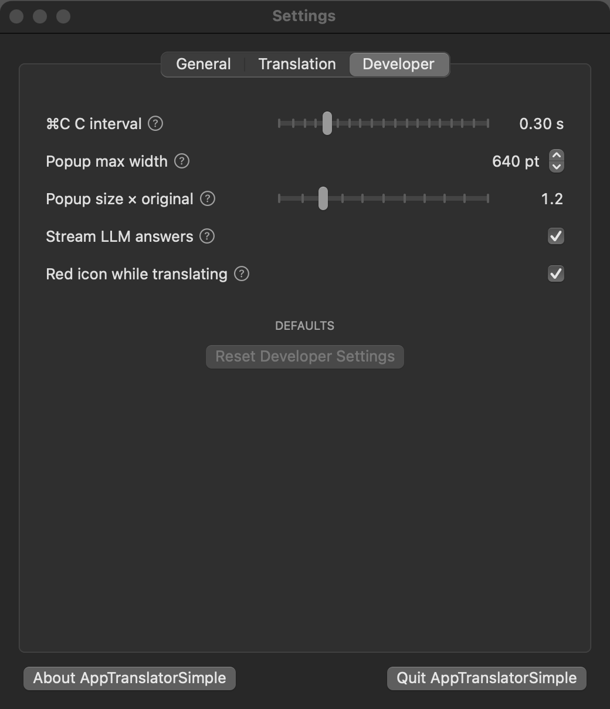

# AppTranslatorSimple


[](LICENSE)
[](https://github.com/NikolaevMikhailRoma/mac-AppTranslatorSimple_n_LLM/releases/latest)
[](https://github.com/NikolaevMikhailRoma/mac-AppTranslatorSimple_n_LLM/releases)



A minimal macOS translator app: copy text twice (⌘C C) and the
translation pops up next to the cursor.

- Russian ↔ English, direction picked automatically. (By counting Cyrillic letters: mostly Cyrillic text is translated into English (can be changed), anything else into Russian (can't be changed).)
- By default, translated text is added to the clipboard (can be disabled);
- Lines broken by a PDF or an e-mail are joined before translating (can be disabled);
- Support several translation methods, including local LLM, Claude, macOS solution;
- The app doesn't collect user data. The text goes only to the method you pick; sending it to an Google, DeepL, Claude or external host is at your own discretion.

## Translation methods

| Method | Status |
| --- | --- |
| Local LLM — any OpenAI-compatible API (tested with LM Studio) | ✅ |
| Claude subscription, through Claude Code | ✅ |
| macOS Translation | ✅ |
| Google Translate, free, no API key | ⚠️ limited |
| DeepL, free, no API key | ⚠️ limited |

The Claude method needs Claude Code signed in with a Claude subscription.

## Settings

<p>
  
  
  
</p>

## Install

Download `AppTranslatorSimple.app.zip` from the [latest release](https://github.com/NikolaevMikhailRoma/mac-AppTranslatorSimple_n_LLM/releases/latest), unzip it and run the app (the first launch may ask for permissions).

## Build from source

```
git clone https://github.com/NikolaevMikhailRoma/mac-AppTranslatorSimple_n_LLM.git
cd mac-AppTranslatorSimple_n_LLM
./build.sh
```

## License

MIT.
